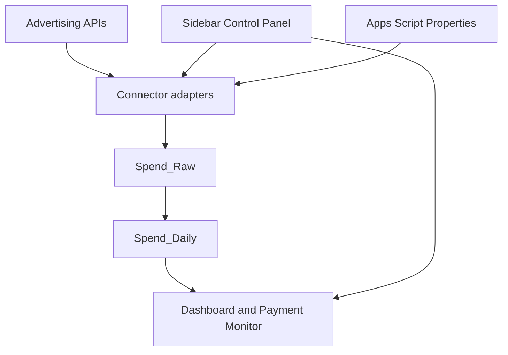

# Architecture

## Runtime flow

The Google Sheet is both the operating surface and the private data store. The
GitHub repository contains deployable source but no runtime state.

## Layers

| Layer | Main files | Responsibility |
|---|---|---|
| Foundation | `Core.gs`, `Code.gs`, `Credentials.gs` | Sheet schema, settings, credential registry, safe logging |
| Shared services | `ApiClient.gs`, `Accounts.gs`, `DataStore.gs`, `Aggregation.gs` | HTTPS/retry, account registry, normalized writes, daily aggregation |
| Connectors | Platform `Auth`, `Accounts`, and `Performance` files | Authentication, discovery, reporting normalization |
| Orchestration | `MasterOrchestrator.gs`, `AutomationTrigger.gs` | Whole-project runs, trigger, range validation, run summaries |
| Experience | `ProjectControlPanel.gs`, `.html`, `Dashboard.gs` | Sidebar, filters, health, payment and dashboard operations |
| Quality | `DataQuality*`, `Dashboard*QA`, `ProjectMaintenance.gs` | Audit, repair, regression QA, reversible workbook cleanup |

## Data movement

1. An operator or time trigger starts a project sync.
2. The orchestrator acquires a lock and resolves enabled accounts.
3. Each connector requests a completed date range and converts platform rows to
   the common record shape.
4. `DataStore.gs` upserts deterministic campaign/day records into `Spend_Raw`.
5. Aggregation rebuilds the affected daily output in `Spend_Daily`.
6. Dashboard and payment-monitor outputs refresh.
7. `Sync_Log` records one project summary; `Platform_Log` records
   connector/account detail; errors are sanitized before persistence.

## Trust boundaries

- **Public:** source, schemas, API endpoint names, Script Property key names.
- **Private workspace:** workbook data, account registry, payment thresholds,
  logs, audit details, Apps Script internal state.
- **Restricted:** tokens, app secrets, private keys, OAuth refresh tokens.
- **External:** advertising APIs and Google Apps Script services only; no custom
  telemetry or third-party data forwarding is implemented.

## Concurrency and failure behavior

- Script locks prevent overlapping project syncs.
- Sidebar sync is queued as a background Apps Script job and can recover a stale
  queued/running state after 30 minutes.
- A range must contain completed dates, must not be in the future, and is capped
  at 31 inclusive days.
- Output rebuild happens after connector processing; failures remain visible in
  sanitized project and platform logs.

